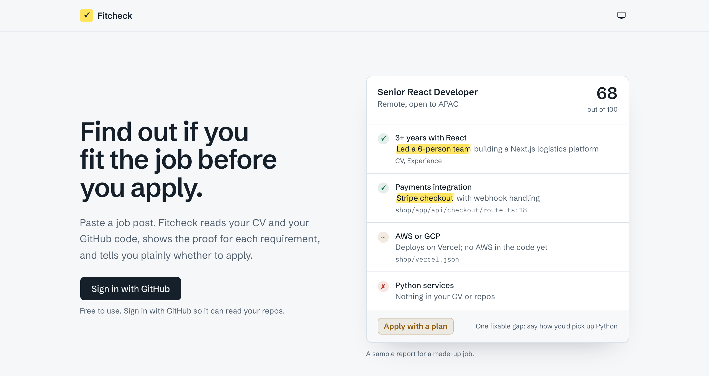
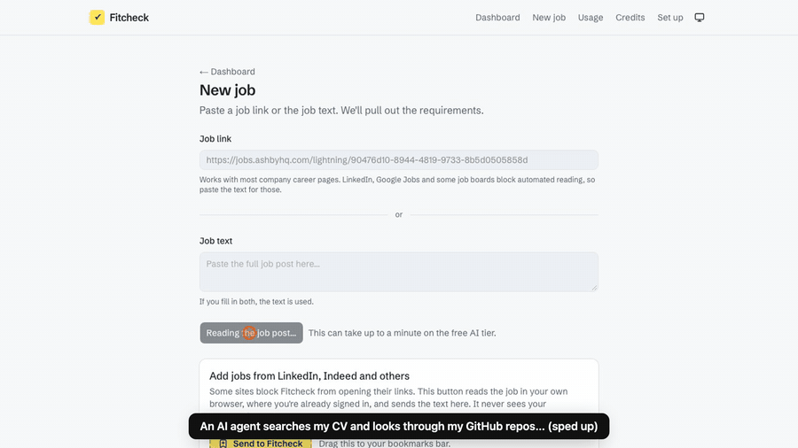
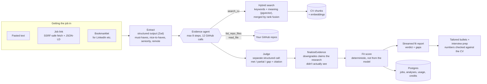
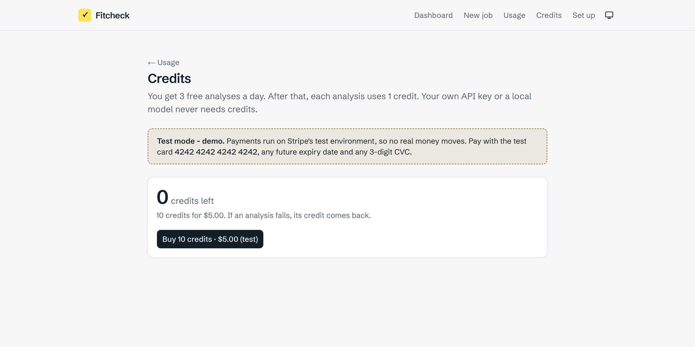

# Fitcheck

**Find out if you fit the job before you apply.** Paste a job post. Fitcheck reads your CV and your GitHub code, shows the proof for each requirement, and tells you plainly whether to apply.

**Live demo:** [fitcheck-psi-three.vercel.app](https://fitcheck-psi-three.vercel.app) · sign in with GitHub, free to use





## The problem

Job posts are long, half of each one is boilerplate, and "5+ years with X" doesn't tell you whether *your* work counts. So people either apply to everything or talk themselves out of jobs they'd get.

Most AI "resume matchers" make it worse: they compare keywords, invent experience, and hand you a confident score with nothing behind it.

Fitcheck does it the way a careful recruiter would:

1. **Pulls out the real requirements.** It separates must-haves from nice-to-haves and drops the fluff, the perks and the application traps.
2. **Looks for proof.** An AI agent searches your CV and reads the GitHub repos you pick, then **cites the line it found** (`shop/app/api/checkout/route.ts:18`).
3. **Gives a plain verdict:** Apply, Apply with a plan, or Skip, with the gaps to address.
4. **Helps you apply honestly.** Tailored CV bullets and interview answers built only from what's real. **Any number it can't find in your CV is flagged** before you use it.

A tracker follows each application from Saved to Offer.

## Architecture



**Design decisions:**

- **The model researches, then judges.** The agent loop only gathers evidence. A separate call with a strict schema decides `met / partial / gap`, so the verdict can't drift mid-conversation.
- **Never trust a citation.** After judging, a "met" that cites a repo file the agent never opened is downgraded to partial, and any requirement the judge skipped becomes a gap.
- **The score is code, not vibes.** Must-haves count double and partial counts half (`lib/agent/score.ts`), so the same evidence always gives the same number.
- **Hybrid CV search, measured.** `search_cv` merges keyword matches with meaning-based matches from pgvector using reciprocal rank fusion, so "REST services" can prove "API design". A chunk found only by meaning must reach a similarity floor (0.65, set by the retrieval eval) because vector search always returns *something*, and each match is tagged `keyword`, `meaning` or `both` so the agent knows to check it. A CV is a few dozen chunks per user, so search is an exact scan filtered by user, with no approximate index; one only pays off when a single search covers far more rows, like searching across every user. Meaning search only runs on the app's own Gemini key: own-key and Local runs keep keyword search and their CV is never sent for embedding.
- **Bounded agent.** It has at most 8 steps and 12 GitHub calls per analysis, so a run costs and takes a predictable amount.
- **Respect the sites.** Fitcheck reads job links politely. Sites that block automated readers (LinkedIn, Indeed, Glassdoor) get a "paste the text" message or the bookmarklet, never a workaround.

## Stack

| Layer | What |
|---|---|
| App | Next.js 16 (App Router, Cache Components, Partial Prerendering), React 19, TypeScript |
| UI | Tailwind CSS v4, shadcn/ui (Base UI), Sonner, next-themes |
| AI | Vercel AI SDK 7: `generateText` + `Output.object`, `streamText`, tool calling |
| Models | Google Gemini 3.5 Flash Lite (free tier, default), Ollama (local), Anthropic Claude (your own key) |
| Data | Postgres on Neon with pgvector, Prisma 7 |
| Auth | Better Auth with GitHub OAuth (also used to read your repos) |
| Payments | Stripe Checkout + signed webhooks, **test mode only** |
| Quality | Bun test (185 unit tests), Playwright (5 end-to-end tests), Biome, three eval suites |
| Hosting | Vercel |

## Evals

AI features need measuring, not eyeballing. Fitcheck has three eval suites with hand-labelled data ([details](evals/README.md)).

| Eval | Data | Result (Gemini 3.1 Flash Lite, the default when measured) |
|---|---|---|
| **Extraction:** does it pull the right requirements out of a post? | 10 fictional job posts with traps (prose requirements, "pgvector is a plus" inside the must list, US-only work authorisation, "put *blue whale* in the subject") | **99.8 / 100**: must-have recall 100%, seniority 100% |
| **Evidence:** does the judge call each requirement correctly? | 5 jobs, 37 requirements labelled against a real CV and repos | **100%** in two runs, **0 overclaims** |
| **Retrieval:** does CV search put the real proof in its top 5? | A fictional CV with deliberate wording gaps, 28 labelled queries (6 with no right answer) | Recall@5: **45.5%** keyword → **86.4%** hybrid, with **0** false hits for both (`gemini-embedding-001`). The 0.65 floor was tuned on these same queries, so treat it as a starting point |

Hybrid search was also run through the evidence eval, on Gemini 3.5 Flash Lite because 3.1 was overloaded that day. Hybrid answered 30 requirements (4 of 5 jobs) and keyword 29 (4 of 5 jobs). Both had no wrong calls and **0 overclaims**, but each lost a different job to the overloaded API, so this is a partial check, not a full rerun.

The extraction eval caught a real bug: a filter meant to drop "time zone overlap" was also dropping "must be authorised to work in the US". Fixing it took the score from 98.4 to 99.8.

```bash
bun run eval:extract --provider google
bun run eval:evidence --provider google
bun run eval:retrieval
```

## Cost and limits

Fitcheck is built to run for **$0**, and every model call is measured.

- **Every call is logged** with its model, tokens, time and success (`UsageEvent`). Each job shows a **"Cost of this job"** panel, and `/usage` shows 14-day totals and a per-step breakdown.
- **A typical analysis** is about **19k tokens in and 1k out, in about 19 seconds**. That's $0.00 on the free Gemini tier, and about **$0.0024** (a quarter of a cent) on Claude Haiku with your own key.
- **The free tier is protected:** **3 free analyses a day** on the app's key. After that, each analysis uses a credit. Your own key or a local model has no limit.
- **Credits (Stripe test mode):** a 10-credit pack through Stripe Checkout. The webhook verifies Stripe's signature, credits only paid sessions that match the pack, and can't add a payment twice. Credits sit in a ledger (`+10` bought, `−1` used, `+1` refunded if an analysis fails), and a per-user lock stops two runs spending the last credit. **Live keys are refused** in code, and the page says "Test mode – demo".



## Bring your own key

In **Set up**, pick a provider:

- **Free (default):** the app's Gemini key, with 3 free analyses a day.
- **Your own key:** Google or Anthropic. The key is checked once, then kept **only in your browser** and sent with each request. It's never stored on the server.
- **Local:** Ollama on your machine. Free, private and unlimited.

## Run it locally

You need [Bun](https://bun.sh), a Postgres database (a free [Neon](https://neon.tech) project works) and a [GitHub OAuth app](https://github.com/settings/developers) with callback `http://localhost:3005/api/auth/callback/github`.

```bash
git clone https://github.com/GhaniaAzhar12/fitcheck.git
cd fitcheck
bun install
cp .env.example .env    # then fill it in; every variable is explained there
bun run db:deploy       # create the tables
bun run dev             # http://localhost:3005
```

### Free and private with Ollama

```bash
ollama pull qwen2.5:7b
# in .env
AI_PROVIDER="ollama"
```

Nothing leaves your machine except the GitHub calls for your own repos. For speed and better tool calling, the free Gemini tier (`AI_PROVIDER="google"` plus a key from [AI Studio](https://aistudio.google.com/apikey)) is the default on the live site.

### Payments (optional, test mode)

Put a Stripe **test** key in `STRIPE_SECRET_KEY`, then forward webhooks and copy the `whsec_…` it prints into `STRIPE_WEBHOOK_SECRET`:

```bash
stripe listen --forward-to localhost:3005/api/stripe/webhook
```

Pay with the test card `4242 4242 4242 4242`, any future date and any CVC.

## Tests

```bash
bun run test        # 185 unit tests: extraction rules, agent tools, search, scoring, pricing, payments
bun run check:vector # pgvector SQL against a throwaway user (no AI calls)
bun run e2e         # 5 Playwright tests against the running app
bun run lint        # Biome
```

The end-to-end tests sign in as a **throwaway test user**, created before the run and deleted after it, using Better Auth's test utilities. They never touch a real account or GitHub login. They cover the home page, signed-out redirects and the GitHub sign-in hand-off, the dashboard, the bookmarklet import, and the test-mode credits page.

## What's next

- **Meaning search with Ollama**, with its own similarity floor and eval run (its scores sit on a different scale from Gemini's).
- **Cover letters** with the same "only what's real" checks as the CV bullets.
- **A browser extension** to replace the bookmarklet, with one-click import on any job site.
- **More eval cases**, especially non-English posts and very senior roles.
- **Live payments** would need a business account; this project stays in test mode on purpose.

## About

Built by [Ghania Azhar](https://www.linkedin.com/in/ghania-azhar/), a full-stack TypeScript engineer, as a portfolio project: an AI feature that's measured, bounded and honest. [Portfolio](https://ghania-azhar.netlify.app/) · [GitHub](https://github.com/GhaniaAzhar12)
